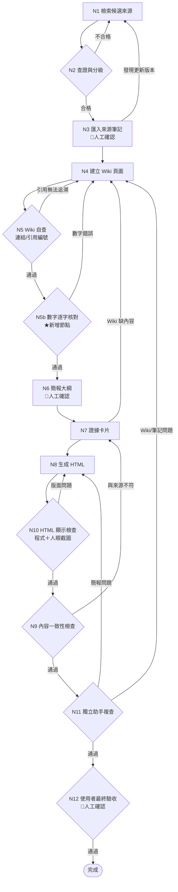

# 工作流程 Graph（v2：實際執行版，2026-11-23）

> v1（設計版）於第三階段建立；v2 依**實際執行**更新。與 v1 的差異見文末「流程調整紀錄」。
> 設計說明：採用 Graph（有回頭修正的路線）。每個檢查節點本身就是「檢查 → 修正 → 再檢查」的小迴圈，因此不另建 loop.md。

## 流程圖（實際執行）

## 節點說明

| 節點 | 工作內容 | 輸入 | 輸出 | 通過條件 | 未通過時 |
|---|---|---|---|---|---|
| N1 檢索候選來源 | 依候選清單搜尋；依「以最新為主」優先找新版 | AGENTS.md §3 | 候選網址 | 涵蓋各類型 | — |
| N2 查證與分級 | 實際開啟網址/DOI；標 🟢🟡🟠 | 候選網址 | 查證結果 | 可開啟、內容相符 | 回 N1 |
| N3 匯入來源筆記 👤 | 撰寫 raw/source-0X.md，逐份給使用者確認 | 原文 | 來源筆記、log | 使用者確認 | 發現更新版本 → 回 N1 |
| N4 建立 Wiki | 依主題整合、加引用與 ⚠️ 區塊 | raw/ | wiki/*.md | 全部頁面完成 | — |
| N5 Wiki 自查 | 程式檢查內部連結、引用編號、頁面結構 | wiki/ | log 紀錄 | 0 失效連結 | 回 N4 |
| **N5b 數字逐字核對** | 用瀏覽器開啟原文，程式搜尋全文比對數字 | raw/、wiki/、原文 | check-01 | 所有使用中的數字皆在原文找到 | 回 N4 修正 |
| N6 簡報大綱 👤 | 每頁標題、版型、重點、來源 | wiki/ | outline.md | 使用者確認 | 修改 |
| N7 證據卡片 | 每頁陳述對應 Wiki 段落與來源；列禁止內容 | outline、wiki/ | evidence-cards.md | 每頁皆有證據 | 回 N4 |
| N8 生成 HTML | 單一檔案、內嵌 CSS/JS/SVG | outline、evidence-cards | index.html | 檔案產生 | — |
| N10 HTML 顯示檢查 | 無頭 Chrome 自動測試＋人眼看截圖 | index.html | check-02、截圖 | 必過項 7、8；無溢出 | 回 N8 |
| N9 內容一致性 | 擷取簡報文字比對證據卡片與禁止清單 | index.html、evidence-cards | check-03 | 必過項 11 | 回 N7/N8 |
| N11 獨立複查 | 未參與製作的 AI 助手唯讀抽查 | 全專案 | check-04 | 無必過項問題 | 回 N4 或 N8 |
| N12 使用者驗收 👤 | 使用者以自己的瀏覽器開啟 | 全專案 | 驗收意見 | 使用者同意 | 回 N6 或 N8 |

## 實際執行紀錄（全部發生於 2026-11-23）

| 順序 | 節點 | 實際發生的事 | 回頭次數 |
|---|---|---|---|
| 1 | N1→N2→N3 ×9 | 9 份來源逐份匯入與確認 | — |
| 2 | N3→N1 | 依使用者「以最新為主」指示，發現 OWASP 2026 版 → S1 改用新版；新增 S8 | 1 |
| 3 | N3 | 「以最新為主」推翻先前越獄歸類的決定（NIST → OWASP） | 決策修改 1 |
| 4 | N4 | 撰寫中自我發現 3 處無法追溯（二手報導資訊、「9 方共同發現」過度概括） | N4 內修正 3 |
| 5 | N5 | 98 個連結 0 失效 | 0 |
| 6 | N5b | 25 項核對：發現 CVSS 只寫 9.3（實為 Microsoft 9.3／NVD 7.5）；3 項說法找不到原文 | 回 N4 1 |
| 7 | N6、N7 | 大綱一次確認；證據卡片未觸發回 N4 | 0 |
| 8 | N8→N10 | 程式全過，但人眼看截圖發現 3 個版面問題 | 回 N8 1 |
| 9 | N9 | 0 問題 | 0 |
| 10 | N11 | 獨立複查發現 11 項 | 回 N4 1、回 N8 1 |
| 11 | N12 | 使用者驗收通過 | 0 |

## 流程調整紀錄（v1 → v2）

| # | 調整 | 原因 | 何時決定 |
|---|---|---|---|
| 1 | 「證據卡片 → 大綱」改為「大綱 → 證據卡片」 | 先決定每頁講什麼，才能替每頁找證據 | 第三階段，使用者同意 |
| 2 | **新增 N5b 數字逐字核對**，從第八階段提前到做簡報之前 | 第四階段用的網頁工具只給摘要，數字待核對；若等簡報做完才查，錯誤數字會先上投影片 | 第五階段結束時，使用者選擇 |
| 3 | N3 增加「發現更新版本 → 回 N1」 | 使用者新增「以最新為主」原則後，需要回頭找新版來源 | 第四階段 |
| 4 | N10（顯示）移到 N9（內容）之前 | 先確定版面不會再大改，再做內容核對，避免改版面時動到文字又要重查 | 第六階段 |
| 5 | N10 由「Claude 內建瀏覽器」改為「工作環境的 Chrome」＋使用者自行開啟 | 內建瀏覽器無法開啟本機 file:// 檔案 | 第六階段 |

## 何時需要……（實際發生的例子）

- **重新檢索資料**：S1 有新版（OWASP 2026）。
- **重新整理 Wiki**：CVSS 分數錯誤、引用追溯鏈斷掉、計數過強。
- **重新生成簡報**：版面看不清楚、術語缺白話解釋、「最強模型」無來源。

## 完成條件（皆已達成）

1. ✅ 5 個必過項（1、2、7、8、11）全部通過
2. ✅ 其他項目的殘留問題皆已記錄於檢查報告
3. ✅ 獨立助手複查完成
4. ✅ 使用者最終驗收同意
5. ✅ 作業成果整理完成（另行繳交，不在本儲存庫）
